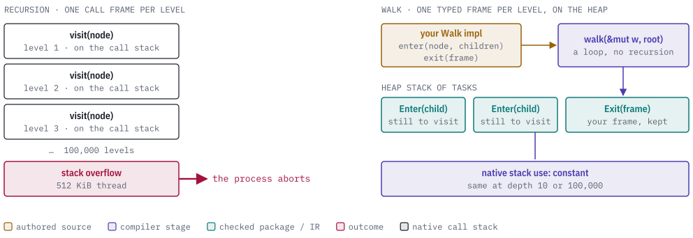
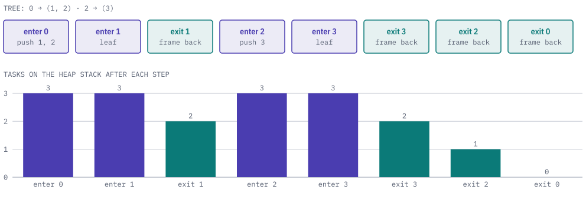
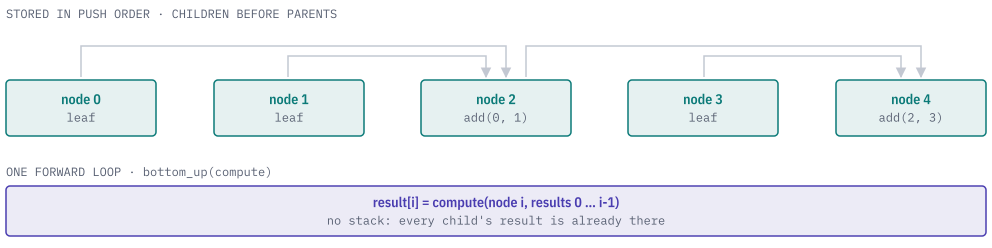

# quire-walk

`quire-walk` is a small `no_std` Rust toolkit for traversing deeply nested
structures. It keeps its own stack of frames on the heap, so native stack use is
constant at any depth.

You describe what to do when a node is entered and when it is left, and the
toolkit runs the traversal from a loop. It also computes bottom-up results over
an arena of nodes with no stack at all. The Quire tools use it to read input
they did not write, such as an expression with 100,000 nested operators, which
would overflow the native stack under a recursive tree walk.

<picture>
  <source media="(prefers-color-scheme: dark)" srcset="docs/images/hero-dark.svg">
  
</picture>

> **Status: public prerelease.** The API is still changing and the crate is not
> published (`publish = false`); depend on it by git. Expect breaking changes.

## Usage

The doc-test in [`src/lib.rs`](src/lib.rs) counts
the nodes of a tree held as lists of child indexes, then stops early at a named
node:

```rust
use core::ops::ControlFlow;
use quire_walk::{walk, Children, Walk};

struct Tree(Vec<Vec<usize>>);

struct Count<'a> {
    tree: &'a Tree,
    entered: usize,
    stop_at: Option<usize>,
}

impl Walk for Count<'_> {
    type Node = usize;
    type Frame = usize;
    type Stop = &'static str;

    fn enter(
        &mut self,
        node: usize,
        children: &mut Children<'_, usize>,
    ) -> ControlFlow<&'static str, usize> {
        if self.stop_at == Some(node) {
            return ControlFlow::Break("found");
        }
        self.entered += 1;
        children.extend(self.tree.0[node].iter().copied());
        ControlFlow::Continue(node)
    }

    fn exit(&mut self, _frame: usize) -> ControlFlow<&'static str> {
        ControlFlow::Continue(())
    }
}

let tree = Tree(vec![vec![1, 2], vec![], vec![3], vec![]]);
let mut count = Count { tree: &tree, entered: 0, stop_at: None };
assert_eq!(walk(&mut count, 0), ControlFlow::Continue(()));
assert_eq!(count.entered, 4);

let mut find = Count { tree: &tree, entered: 0, stop_at: Some(2) };
assert_eq!(walk(&mut find, 0), ControlFlow::Break("found"));
```

## Walk order

You implement the `Walk` trait, which declares three types and two callbacks:

- `Node` is the handle of a node to visit (a reference or an index), `Frame` is
  what you keep for a node between entering and leaving it, and `Stop` is the
  value you return to end the walk early.
- `enter` is called once per node, before any of its children. It names the
  children to visit by pushing them onto `children`, and returns the node's
  frame.
- `exit` is called once per node, after every child has been exited, and gets
  that same frame back.

`walk` visits each child and its whole subtree before the next child. On any
path from the root to a leaf, exits come in the reverse order of the enters.
Returning `ControlFlow::Break` from either callback ends the walk at once:
`walk` returns that value, no callback runs after it, and children already named
are dropped.

The figure shows the walk from the example above. The heap stack holds one
frame for each node entered but not yet exited, plus one entry for each child
named but not yet entered. Its size follows the nodes the walk names and is
independent of call depth.

<picture>
  <source media="(prefers-color-scheme: dark)" srcset="docs/images/order-dark.svg">
  
</picture>

A walk over several kinds of node, such as expressions that hold types and types
that hold expressions, declares an enum for `Node` and one for `Frame`, with a
variant per kind, so each level carries a frame of its own kind.

## Bottom-up arena

When a result depends only on a node's children, no stack is needed. An
`Arena<T>` is one vector in which every node is stored after its children.
`Arena::push` returns a typed `Id<T>`, and a parent can only be built from ids
that already exist, so children always sit at lower positions. `Arena::bottom_up`
then computes one result per node in a single forward loop; each node reads its
children's finished results through `Results::get`.

<picture>
  <source media="(prefers-color-scheme: dark)" srcset="docs/images/arena-dark.svg">
  
</picture>

The arena has two properties:

- `Clone`, `PartialEq`, `Debug` and drop all run over the flat vector, so none
  of them recurse in proportion to depth.
- Each arena has its own token and every `Id` carries it. `Arena::get`,
  `Results::get` and `Computed::get` return `None` for an id from another
  arena, a clone included, so an id never reads a node of another arena.

## Reference

| Item | What it is |
| --- | --- |
| `Walk` | The trait you implement: `Node`, `Frame`, `Stop`, `enter`, `exit`. |
| `walk(&mut walker, root)` | Runs a walk depth first; returns `ControlFlow<Stop>`. |
| `Children` | Passed to `enter`; `push` or `extend` to name children in visiting order. |
| `Arena<T>` | Children-first node storage: `push`, `get`, `len`, `is_empty`, `iter`, `bottom_up`. |
| `Id<T>` | Typed, arena-bound handle; `Copy`, `Eq`, `Ord`, `Hash` whatever `T` is. |
| `Results`, `Computed` | The results seen during `bottom_up`, and the finished set (`get`, `len`, `into_vec`). |

The crate has no dependencies beyond `core` and `alloc`, no cargo features, and
forbids `unsafe` code, so any `no_std` crate can depend on it without feature
unification adding anything else. The tests in [`tests/it`](tests/it) walk
100,000-deep chains and build 100,000-node arenas on a thread with a 512 KiB
stack, and check that the crate has no features and no dependencies.
[`src/proofs.rs`](src/proofs.rs) holds bounded-model-checking harnesses for
[Kani](https://github.com/model-checking/kani).

## Quire ecosystem

`quire-walk` is a foundation library at the bottom of the Quire repositories.
It depends on no other Quire repository. [quire-spec-language](https://github.com/agent-ix/quire-spec-language)
uses it for its deep traversals.

<picture>
  <source media="(prefers-color-scheme: dark)" srcset="docs/images/ecosystem-dark.svg">
  
</picture>

## Building and testing

The Makefile provides these gates:

| Command | What it does |
| --- | --- |
| `make test` | `cargo test`, including the 100,000-deep stack-safety tests. |
| `make lint` | Clippy with warnings denied, also for a bare-metal target. |
| `make build-no-std` | Builds for `thumbv7em-none-eabi` to check that nothing from `std` is used. |
| `make kani` | Runs the Kani proof harnesses; needs `cargo-kani`, not part of `ci`. |
| `make ci` | Format check, lint, tests, no-std build, `cargo deny` and docs. |

Run `make ci` locally before opening a pull request.

## Contributing

Contributions need the [CLA](CLA.md). See [CONTRIBUTING.md](CONTRIBUTING.md) and
[AGENTS.md](AGENTS.md).

## License

[AGPL-3.0-or-later](LICENSE).
